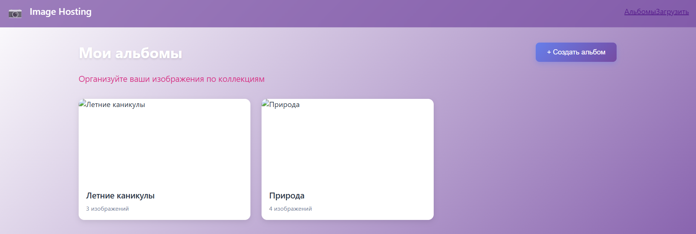

# Image Hosting Service

Веб-приложение для организации и хранения изображений в виде альбомов. Проект реализован как монорепозиторий на базе npm workspaces с разделением на клиентское SPA, серверное API и библиотеку общих UI-компонентов.

## 📸 Скриншоты

### Главная страница — список альбомов


### Страница альбома — галерея изображений


## 🛠 Технологический стек

- **React 19** — UI-фреймворк
- **React Router 7** — клиентская маршрутизация
- **Vite 5** — сборка клиента
- **Express 4** — серверное API
- **TypeScript 5.3.3** — строгая типизация
- **Jest + ts-jest + @testing-library/react** — тестирование
- **ESLint + @typescript-eslint** — линтинг
- **CSS** — стилизация

## 📁 Структура проекта

```
image-hosting-service/
├── apps/
│   ├── client/          # SPA на React 19 + Vite
│   └── server/          # REST API на Express
├── packages/
│   └── ui/              # Библиотека переиспользуемых React-компонентов
├── architecture.md      # Архитектура проекта
├── mvp.md               # Функциональные требования к MVP
└── README.md            # Данный файл
```

## 🚀 Быстрый старт

### 1. Установка зависимостей

```bash
npm install
```

### 2. Запуск в режиме разработки

```bash
npm run dev
```

Клиент будет доступен по адресу `http://localhost:5173`, сервер — `http://localhost:3000`.

Запуск отдельных проектов:

```bash
npm run dev --workspace=@image-host/client
npm run dev --workspace=@image-host/server
```

### 3. Сборка для продакшена

```bash
npm run build
```

Сборка выполняется в порядке: UI → Client → Server. Результаты попадают в папки `dist/` каждого проекта.

## ✅ Тестирование

```bash
npm run test
```

Запускает все тесты с отчётом о покрытии. Покрытие библиотеки `@image-host/ui` — **≥ 70%** по всем метрикам (statements, branches, functions, lines).

Просмотр HTML-отчёта о покрытии:

```bash
npm run test:coverage
```

## 🔍 Линтинг

```bash
npm run lint
```

Проверка кода через ESLint. Команда выполняется без предупреждений и ошибок.

Автоматическое исправление проблем:

```bash
npm run lint:fix
```

## 📜 Доступные скрипты

| Команда | Описание |
|---|---|
| `npm run build` | Сборка всех проектов |
| `npm run dev` | Запуск dev-серверов |
| `npm run lint` | Проверка кода ESLint |
| `npm run lint:fix` | Автоисправление ошибок линтера |
| `npm run test` | Запуск тестов с покрытием |
| `npm run test:coverage` | Тесты с детальным отчётом покрытия |

## 📚 Документация

- [**architecture.md**](./architecture.md) — архитектура проекта, стек, компоненты, роутинг, инструкции по запуску.
- [**mvp.md**](./mvp.md) — функциональные требования, use cases, границы MVP, план развития.

## ⚙️ Конфигурация TypeScript

Во всех проектах включены строгие настройки:

- `strict: true`
- `noImplicitAny: true`
- `noUnusedLocals: true`
- `noUnusedParameters: true`
- `esModuleInterop: true`

Использование `any`, `var`, `require` и `module.exports` в исходном коде **запрещено**.

## 🧩 UI-библиотека `@image-host/ui`

Переиспользуемые компоненты с полным тестовым покрытием:

| Компонент | Назначение |
|---|---|
| `Button` | Кнопка с состояниями `disabled`, `onClick` |
| `Header` | Шапка приложения с логотипом и слотом навигации |
| `Input` | Текстовое поле с label и placeholder |
| `Select` | Выпадающий список с вариантами |
| `FileUpload` | Зона выбора файла |
| `ImageCard` | Карточка изображения с опциональным заголовком |
| `AlbumCard` | Карточка альбома с обложкой и счётчиком |

Покрытие библиотеки: **Statements 97%**, **Branches 89%**, **Functions 93%**, **Lines 96%**.
